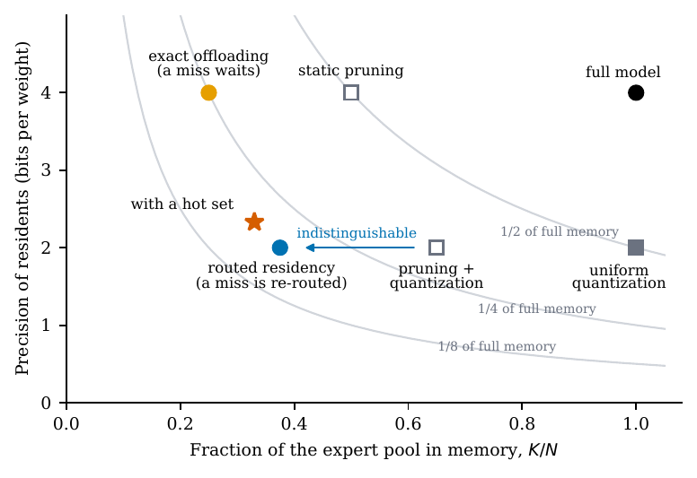
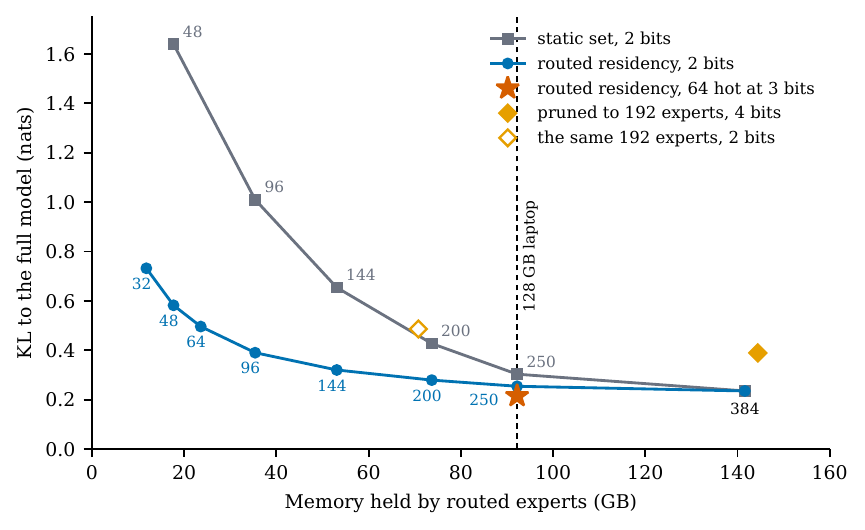
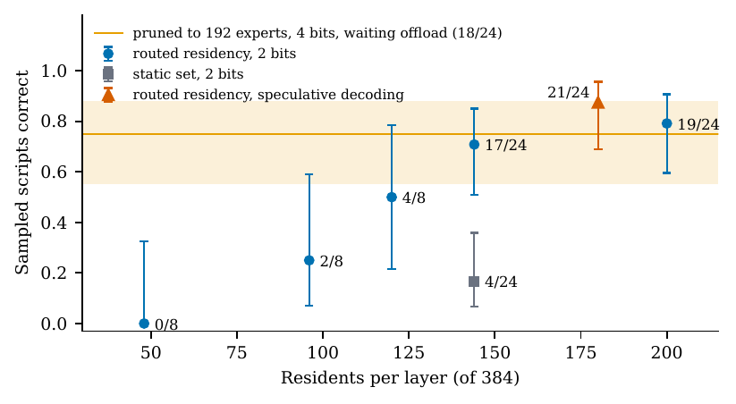

# KEEP: Pruning Is a Frozen Cache

Code and paper for running a mixture-of-experts (MoE) language model that does not fit in memory,
by treating expert pruning, quantization and offloading as one problem.

**Paper:** [*Pruning Is a Frozen Cache: Unifying Pruning, Quantization and Offloading in
Mixture-of-Experts Inference*](docs/deepseek-v4-flash/paper/paper.pdf)
([LaTeX source](docs/deepseek-v4-flash/paper/paper.tex)).

**Case study:** [DeepSeek-V4.1-Flash-1017](https://huggingface.co/deepseek-ai/DeepSeek-V4.1-Flash-1017)
(40 layers, 384 experts per layer, 6 active per token) served on one Apple M4 Max with 128 GB.
Its experts do not fit on that machine at the released 4 bits or at 2 bits. With the method
here the machine reaches every expert of the model and decodes at 23 to 27 tokens per second,
30 to 40 with the model's speculative decoder.

The evidence for the order of spending is one model, one set of codes and one machine; a
[second model](#a-second-model-glm-53-flash) confirms the residency result alone. The formulation is general; the
measurements are a case study. [What is not shown](#what-is-not-shown) lists the gaps.

## What KEEP and RAMP mean

The repository holds two pieces of software and is named after the first.

**KEEP** stands for *KL-distilled Expert Encoding and Precision*. It is the compression side: it
decides how each expert is stored.

- *Expert encoding* is the lattice code that stores an expert's weights at about 2 bits each.
- *Precision* is the choice of how many bits each expert gets.
- *KL-distilled* names the yardstick. The full model is the teacher, and every compressed model
  is measured against the teacher's next-token distribution by KL divergence.

**RAMP** stands for *Routed Accelerated MoE Pipeline*. It is the runtime side: it runs the
compressed experts on an Apple GPU with MLX and Metal kernels.

- *Routed* because the model's router picks a few experts per token, and the runtime decodes
  only those.
- *Accelerated* because the decode from lattice codes happens inside GPU kernels, with no
  full-precision copy of the weights in memory.

In the paper's terms, KEEP supplies precision (the codes and their bit widths), and RAMP's
kernels are what the serving code uses to apply reach, residency and the miss rule on every
token. The paper's fitting and serving scripts import both libraries.

## The problem

A sparse MoE layer holds many feed-forward experts and a router that sends each token to a few
of them. Current open models route among hundreds:

| Model | Experts per layer | Active per token | Share of expert weights a token uses |
|---|---:|---:|---:|
| GLM-5.3 | 256 | 8 | 3.1% |
| GLM-5.3-Flash | 288 | 8 | 2.8% |
| DeepSeek-V4.1-Flash-1017 | 384 | 6 | 1.6% |
| Kimi K3.1 Pro | 896 | 16 | 1.8% |

The weights a token does not touch need not be in fast memory (offloading), need not be kept at
all (pruning), or need not be kept precisely (quantization). These three techniques are built
and studied separately, yet each answers the same question: which bytes are in memory when a
token arrives.

## One formulation: reach, residency, precision and a miss rule

Any memory-constrained MoE deployment is described, per layer, by three quantities and one rule.

- **Reach**: the experts the router is allowed to select. Pruning shrinks it.
- **Residency**: the experts in memory. Offloading makes it smaller than reach.
- **Precision**: the bits each resident expert carries. Quantization lowers it.
- **Miss rule**: what happens when a selected expert is not resident.

| Miss rule | What it does | Cost |
|---|---|---|
| Wait | block the token until the expert is read | latency |
| Substitute | serve the miss from a coarse copy kept in memory | memory for the copies, and their error |
| Re-route | serve the token from the best experts that are resident | a lower-ranked expert runs |
| Skip | drop the missed choice | its contribution is lost |

Existing methods are points in this space, and most differ mainly in the miss rule. Static
pruning is the point whose resident set never changes and whose reach has been cut to match:
**a cache that never admits**. Exact offloading is the point that always waits.



Reach costs no memory. It costs storage and read traffic. That one observation drives most of
what follows.

## Routed residency

The policy the paper studies uses the model's own router as the cache controller.

1. The router scores every expert of the full pool, as in the unpruned model.
2. The token is served by the best experts that are resident. No token waits for storage.
3. An expert that was wanted but absent is read in the background if it was wanted strongly
   (gate weight at or above a threshold τ, 0.3 in the case study). It becomes selectable only
   when its bytes are in place.
4. The resident that has gone longest without strong demand is evicted.
5. Optionally, a nested residual code adds a third bit to the most used ("hot") experts.

Static pruning is the special case τ = ∞. The implementation is a bias on the router: absent
experts get a bias of minus infinity, so one router evaluation yields both the served set (top
k over biased scores) and the demand (top k over unbiased scores), and the decode path waits on
neither storage nor the host.

Re-routing a miss and admitting it in the background are not new. SwapMoE, LightMoE and Son's
*Which Expert Misses Are Worth Waiting For?* each do a version of it, and SpecMD benchmarks
miss policies. What this work adds is the common account above, an allocation rule that follows
from it, and a measurement of a policy that never waits against pruned sets of equal memory at
2 bits. The paper's related-work section gives the details.

## An order for spending memory

Because every setting shares one memory account, the value of a gigabyte can be compared across
uses. A two-term error model (demand that is re-routed, and coding error on what is served)
predicts an order:

1. **Precision first, up to the knee of the code.** Below some precision a code stops
   preserving what an expert computes, and holding the expert is worth little.
2. **Then reach, for free.** Let the router select from the whole pool.
3. **Then residents.** While the resident set is small, each added expert removes routing error
   on many choices.
4. **Then precision again, for the hot set.** Once most demand is served from memory, a
   residual on the most used experts buys more than one more resident.

The order should hold for wide, sparsely used pools with demand that is concentrated and local
to a session. It should fail for narrow pools (eight experts, two active), where precision
should come first throughout.

## Case study: DeepSeek-V4.1-Flash-1017 on a 128 GB Mac

Quality is the KL divergence to the full model's next-token distribution, in nats, teacher
forced, on the first 1,024 tokens of 17 distinct texts from ten domains. Differences are paired
by text with a 95% bootstrap interval. Codes are 2-bit E8P lattice codes (2.04 bits per
weight).

### Routed residency against a static set, same codes, same memory

| Residents per layer | Expert memory | Static set | Routed residency | Difference |
|---:|---:|---:|---:|---|
| 48 | 18 GB | 1.640 | 0.582 | −1.058 [−1.365, −0.832] |
| 96 | 35 GB | 1.010 | 0.390 | −0.619 [−0.829, −0.460] |
| 144 | 53 GB | 0.654 | 0.320 | −0.333 [−0.472, −0.229] |
| 200 | 74 GB | 0.427 | 0.279 | −0.148 [−0.246, −0.078] |
| 250 | 92 GB | 0.303 | 0.254 | −0.048 [−0.092, −0.016] |
| 384 (all) | 142 GB | 0.235 | 0.235 | |

Routed residency is closer to the full model at every budget. On these texts a routed set is not
separable from a static set 1.7 to 2 times its size (96 against 200, 144 against 250); held-out
texts qualify that, see [What is not shown](#what-is-not-shown).



### Residents against bits

Holding memory fixed and moving it from residents to a third bit on a hot set:

| Budget | Result of trading residents for a hot set |
|---:|---|
| 35 GB | worse, +0.014 [+0.004, +0.024] |
| 53 GB | level, −0.004 [−0.014, +0.005] |
| 74 GB | better, −0.023 [−0.042, −0.002] |
| 92 GB | better, −0.039 [−0.058, −0.017] |

The crossover lies between 144 and 200 residents, 38 to 52% of the pool. Below the knee the
order also holds: 192 experts at 1 bit are far worse than 96 at 2 bits in the same memory
(1.172 against 0.801).

### A running system

Built inside an existing MLX runtime ([oMLX](https://github.com/jundot/omlx)) without modifying
it, on an M4 Max with 128 GB:

- The runtime's own waiting offload is seven times slower than a static set of the same size.
- Routed residency costs 7 to 9% of decode speed against a static set from the same pool, for
  scoring demand and installing about two experts per token. That is over two or three requests
  each, beside a 25% run-to-run spread, so the cost is small but not resolved.
- The whole pool of 384 is served at 23 to 27 tokens per second with 144 residents in 63 GiB,
  and at 30 to 40 with the model's speculative decoder.

### A limit: the residency floor

KL under forced context does not predict free-running generation when too few experts are
resident. On one sampled coding request, counting scripts that run and give the right output:

| Configuration | Residents | Correct |
|---|---:|---:|
| Pruned checkpoint at 4 bits | 192 | 18 of 24 |
| Routed residency, 2 bits | 200 | 19 of 24 |
| Routed residency, 2 bits | 144 | 17 of 24 |
| Routed residency, 2 bits | 96 | 2 of 8 |
| Routed residency, 2 bits | 48 | 0 of 8 |
| Static set, 2 bits | 144 | 4 of 24 |

At 96 residents KL matches the pruned checkpoint's (0.390 against 0.389), yet the scripts break,
mostly through misspelled identifiers. The order of spending therefore applies above a floor,
here somewhere between 96 and 144 of 384 experts per layer. The static-set row ran with the
speculative decoder on; under the same launcher the routed set scored 5 of 8 (p = 0.023).
This is one prompt, with no count for the full model.



The floor belongs to the miss rule. Served on 2026-11-21 with the residents that fit a 64, 96 or
128 GB machine (the two smaller emulated by wiring 64 or 32 GiB), ten requests a row:

| Machine | Residents | Re-route | Wait at weight 0.3 | Wait for every miss |
|---|---:|---|---|---|
| 64 GB | 73 | 0 of 10, 25.3 tok/s | 9 of 10, 16.5 tok/s | 10 of 10, 6.0 tok/s |
| 96 GB | 140 | 7 of 10, 24.5 tok/s | 9 of 10, 21.1 tok/s | 10 of 10, 10.8 tok/s |
| 128 GB | 207 | 10 of 10, 25.7 tok/s | 9 of 10, 20.6 tok/s | 10 of 10, 11.5 tok/s |

Waiting for every miss is the whole pool's output at these codes. One prompt, one run a row, and
the emulation removes memory, not compute.

## A second model: GLM-5.3-Flash

The comparison of routed and static residency was repeated on
[GLM-5.3-Flash](https://huggingface.co/zai-org/GLM-5.3-Flash) (288 experts per layer, 8 active),
with every expert at the model's released precision, so nothing is fitted and only residency
differs. Resident counts and the admission threshold are the case study's.

| Residents per layer | Share of pool | Static set | Routed residency | Difference |
|---:|---:|---:|---:|---|
| 72 | 25% | 1.276 | 0.648 | −0.628 [−0.753, −0.509] |
| 108 | 37.5% | 0.774 | 0.457 | −0.317 [−0.445, −0.223] |
| 150 | 52% | 0.482 | 0.312 | −0.171 [−0.227, −0.128] |

Routed residency wins at every budget and in each of the 17 texts. Against larger static sets it
is worth about 1.4 times its size, not two: 108 routed residents are not separable from 150
static ones. Two things differ from the first model. The policy admits about five times as many
experts per token here, a read load we did not test on storage. And this model's demand is less
local: each text's own best 108 experts hold 85% of its gate weight, against 96% for the first
model.

An earlier version of this table came from a run that applied the admission threshold on the
wrong scale (2.5 times too strict). The numbers above are from the corrected run; both are in
the results directory.

This run tests residency only. Codes, the residents-against-bits trade, generation and serving
were not tested on this model. The code is in [`scripts/runpod/glm53/`](scripts/runpod/glm53/)
and the per-text results in [`docs/glm-5.3-flash/results/`](docs/glm-5.3-flash/results/).

## What is oMLX's and what is ours

[oMLX](https://github.com/jundot/omlx) is an MLX inference server by other authors, under
Apache-2.0. It already runs DeepSeek-V4.1-Flash-1017 and has its own expert offload. We did not
fork or modify it. Our scripts start oMLX at a pinned commit (`4213c328`) and replace parts of
the loaded model in process, so the comparison below is with that commit only.

**Used from oMLX unchanged:** the server and its OpenAI-compatible API, tokenization and chat
encoding, model loading, attention, the Engram tables and their SSD offload, the shared expert
and its kernels, the router's scoring kernel, sampling, and the speculative decoder.

**Replaced by this repository:** the routed experts of every layer, meaning how they are stored,
which ones are in memory, what happens on a miss, and the kernels that run them.

| | oMLX's expert offload | This repository |
|---|---|---|
| Goal | exact output: routing is computed as shipped | bounded latency: no token waits |
| Miss rule | wait. The token blocks until the missed expert is read | re-route. The token runs on the best resident experts |
| Output | identical to the fully resident model | inexact on a miss, measured in the case study |
| Admission | every missed expert is read | only an expert demanded with gate weight at or above τ, read in the background |
| Eviction | lowest decayed use count | least recently strongly demanded, with spare slots kept free |
| Expert format | the checkpoint's 4-bit format (18.8 MB an expert), or oMLX's 2 to 8-bit affine quantization | 2-bit lattice codes (9.0 MB an expert), with an optional nested third bit for a hot set |
| Reach | the experts of the loaded checkpoint | all 384 per layer, even when the loaded checkpoint is pruned: the pool comes from the codes |
| Decode path | oMLX's fused decode kernels do not apply while its offload is on | our Metal kernels for the routed experts, oMLX's for everything else |
| Resident count | set as a fraction of the experts | chosen from the machine's RAM |

Measured on the same machine, oMLX's waiting offload decodes seven times slower than a static
set of the same size, and routed residency 7 to 9% slower than a static set from the same pool.
That is the price of each miss rule, not a ranking: oMLX's offload returns exactly the full
model's output and ours does not.

The files: [`omlx_compact.py`](scripts/v41_build/omlx_compact.py) builds a fixed resident set
that oMLX's fused kernels can run, [`omlx_routed.py`](scripts/v41_build/omlx_routed.py) adds
demand, the cache policy and installs that never stall a token, and
[`omlx_lattice.py`](scripts/v41_build/omlx_lattice.py) swaps the experts for 2-bit lattice
codes with their own kernels and a pool wider than the checkpoint.

## What is not shown

- **The order of spending rests on one model.** The second model tests residency alone. GLM-5.3
  and Kimi K3.1 Pro were not measured, and the prediction for narrow pools is untested.
- **Settings were chosen on the evaluation text.** A held-out run on 36 untouched texts confirms
  the main comparison: routed beats static by 0.503 KL at 144 residents (35 of 36 texts) and 0.793
  at 96 (36 of 36). It also shows a limit: on texts under 256 tokens the routed set has had no time
  to adapt and is worse than a static set 1.7 times its size; on long texts the two are not separable. The
  precision results were not rescored on held-out text.
- **Generation was tested with one prompt**, and without a full-model baseline, which does not
  fit on the machine.
- **No selective wait.** Son reports that waiting only for the strongest misses costs far less
  than re-routing every miss. The policy here never waits and was not compared with that.
- **No comparison with other runtimes at equal memory.** The only wait rule measured is oMLX's, on
  a different checkpoint and precision. Speed ranges cover two or three requests, beside a 25%
  run-to-run spread.
- **Quality is from a simulator** whose timing is more favorable than the served system's; their
  agreement on quality was not measured.

The full list is in [`docs/deepseek-v4-flash/paper/OPEN.md`](docs/deepseek-v4-flash/paper/OPEN.md).

## Using the code

### Setup

macOS on Apple silicon, with [uv](https://docs.astral.sh/uv/):

```bash
git clone https://github.com/jackmaxwil/keep.git
```

```bash
cd keep && uv sync --group dev
```

### Serve the model

```bash
scripts/v41_build/run_v41.sh BUNDLE
```

`BUNDLE` is a directory holding a slim checkpoint, 2-bit codes for all 384 experts per layer,
the full model's router rows and a pool file. The script checks the machine, installs oMLX at a
pinned commit on the first run, picks the resident count from RAM and prints an
OpenAI-compatible endpoint.

**The bundle is not published and is not in this repository.** It is 340 GiB. Building one needs
the full checkpoint's experts, a code fit of several hours and
[`slim_checkpoint.py`](scripts/v41_build/slim_checkpoint.py); the steps are recorded in the
[build plan](docs/deepseek-v4-flash/2026-11-10-v41-wow-build-plan.md). Generated code was
unreliable below about 120 residents, which is a 96 GB Mac with the speculative decoder off.

The pruned checkpoints used as baselines are public:
[REAP-50](https://huggingface.co/jackmaxwil/DeepSeek-V4.1-Flash-REAP-50) and
[REAP-75](https://huggingface.co/jackmaxwil/DeepSeek-V4.1-Flash-REAP-75).

### Rebuild the paper

```bash
cd docs/deepseek-v4-flash/paper && tectonic paper.tex
```

```bash
cd docs/deepseek-v4-flash/paper && uv run --with matplotlib --with numpy python figures.py
```

`stats.py` and `routing.py` recompute every number in the quality tables from stored
evaluation outputs. Those outputs, the weights and the fitted codes are not in the repository.

## Where things are

| Path | What it holds |
|---|---|
| [`docs/deepseek-v4-flash/paper/`](docs/deepseek-v4-flash/paper/) | The paper, its figures, and the scripts that produce its numbers |
| [`scripts/v41_build/`](scripts/v41_build/) | The serving code: the routed cache (`omlx_routed.py`), the 2-bit lattice expert cache and its Metal kernel (`omlx_lattice.py`), the launcher, the slim-checkpoint tool |
| [`scripts/runpod/v41_reap/`](scripts/runpod/v41_reap/) | The simulator that applies residency decisions inside the real forward pass (`local_eval.py`), code fitting (`keep_quant.py`), pruning and calibration tools |
| [`src/keep/`](src/keep/) | KEEP, the compression library: lattice codebooks, quantizers, converters |
| [`src/ramp/`](src/ramp/) | RAMP, the MLX runtime: model adapters and GPU kernels |
| [`docs/deepseek-v4-flash/`](docs/deepseek-v4-flash/) | Dated plans, the build plan and the experiment log behind the paper |
| [`tests/`](tests/) | Tests, with small fixtures |

## Earlier work in this repository

KEEP and RAMP (defined [above](#what-keep-and-ramp-mean)) began as a pipeline that compresses a model's experts to about 2 bits per weight
and runs them with MLX. That pipeline compressed DeepSeek-V4-Flash-0731 to a 75.25 GB expert
payload at 2.031 bits per weight, and has adapters for GLM-5.3-Flash, GLM-4.5-Air and
Qwen3.6-35B-A3B. Its setup guide, commands and model table are in
[`docs/keep-ramp-pipeline.md`](docs/keep-ramp-pipeline.md).

## Citation

```bibtex
@misc{mazac2026frozencache,
  title  = {Pruning Is a Frozen Cache: Unifying Pruning, Quantization and Offloading in Mixture-of-Experts Inference},
  author = {Mazac, Jack},
  year   = {2026},
  note   = {Preprint},
  url    = {https://github.com/jackmaxwil/keep}
}
```

## License

Apache-2.0, see [`LICENSE`](LICENSE). The reference files in
[`tests/fixtures/v41_reference`](tests/fixtures/v41_reference) are DeepSeek's and keep their MIT
license.
