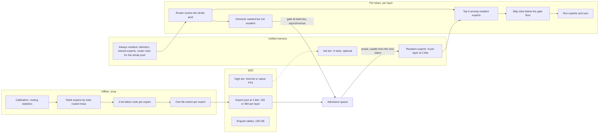

# Routed residency: plan to the paper (revision 3)

Revised late on 2026-11-09 after a critique of revision 2 (in git at `691f97a`). Score on the fixed
rubric in the [recovery log](2026-11-08-v41-reap-recovery-log.md): **31 / 100**; the rubric and its
weights do not change. Evidence for every number here is in the
[findings note](2026-11-09-keep-findings-and-levers.md); prior art is its section 7.

## 1. Thesis

Pruning is a cache that never updates. Keep every resident expert at a usable precision (2 bits),
let the set of resident experts follow the session, and send a token whose expert is absent to the
best resident one instead of to a worse copy. Precision above 2 bits is a second, smaller question.

This is a conjecture (C1 below), not a result. What is measured so far: a routed cache of
residuals beats a fixed one by 0.068 KL; a 1-bit fallback is the dominant cost; dropping low-gate
slots is free; the second bit is worth more than breadth.

## 2. Target architecture

- Decode never waits on the SSD: a miss is re-routed now and admitted for later tokens.
- Static pruning is this system with admissions switched off. Per-token dropping is the gate floor.
  Quantization is the precision of the resident copy. One budget, in resident GB, covers all three.
- Open in this picture: the pool size (192 or all 384), whether a hot tier pays, and the real
  resident size of everything that is not a routed expert.

## 3. Rules

1. **Two numbers per comparison.** KL on teacher-confident positions (teacher NLL below 2) is
   general quality; agreement on the rest is fidelity on agentic and tool-call text. A change that
   moves only the second is reported as that.
2. **Spend memory where it pays.** The second bit is worth about three times more per unit than
   the last 48 experts, and a 1-bit base loses at every budget. One sweep asks where the next unit
   goes: a resident expert, a third bit, or a native copy.
3. **Use the slack.** The routed cache read 0.28–0.83 GB/s against a 2.5 GB/s ceiling, so whole
   2-bit experts (2 units) and native copies (4 units) are affordable to move.
4. **Fix the fallback before the policy.** No work on admission rules unless the oracle gap exceeds
   0.015 KL.
5. **Fail fast.** Score a partial result end to end before finishing it; write the prediction
   before the run; estimate from measured throughput.

## 4. Critique of the approach so far

| Hole | Why it matters | What closes it |
|---|---|---|
| We never tested the simplest design: a 2-bit expert cache with re-routing on a miss. We were anchored on residuals. | Pruning costs 0.578 KL and 2-bit coding 0.169; the residual work chased the smaller loss with a fallback that could not work. | E1, tonight, no new fits. |
| Every result is teacher-forced KL. No text has been generated. | A 0.03 KL threshold is not tied to anything a user sees; the selection gain sits mostly on positions the teacher did not expect. | Rule 1 now; a generation check (E6) before any public claim. |
| The offload result is a simulation, and V4.1 has no decoder on this Mac. | "On a laptop" rests on a trace replay, an assumed 30 tok/s, and an SSD shared with 190 GB of Engram lookups. | W6 replay states exactly that; real decode only on the second model (E8). A stated limitation. |
| The memory axis counts routed experts only. | Attention, the KV cache and the Engram page cache are resident too, and this Mac thrashed at 91 GB. The true budget may sit below 384 units. | Measure total resident size once; plot the frontier in total GB. |
| τ and K were picked on the eval set. | Selection bias in our own favour. | Tune on the Mac set; confirm once on the pod's untouched 54 sessions (shard 1/2). |
| The eval set is thin: domains with one session, shared prompts, sessions of 11 tokens. | Domain means swing on one text. | Eval set version 2; session-level intervals; all 108 sessions for the final table. |
| The static baseline was REAP-50. | A better static set exists (total mass), so a win over REAP-50 flatters the method. | Static baselines use the total-mass set after the re-base. |
| The third-bit bet has a thin margin. | Everything above 2 bits is worth at most 0.169 KL on this pool. | C3 is tested after C1 and C2, not before. |
| The selection claim may contradict REAP's own comparisons against frequency-based criteria. | A reviewer will know that paper. | W0 reads it; C7 adds a generation test. To verify: this is from memory of the paper. |
| Three avoidable pod failures in one evening, the last a volume filled by mixing GB and GiB. | About $8 and two hours. | Section 9. |

## 5. Conjectures the paper proves or refutes

Each is stated so that a single run can refute it. KL is domain-mean; "confident" means positions
with teacher NLL below 2; intervals are session-level bootstrap.

| # | Conjecture | Test | Refuted if |
|---|---|---|---|
| C1 | **Residency should follow the session.** With the same codes, memory and miss rule, an LRU expert cache with demand admission beats the best static expert set. | E1: pool of 192 at flat 2 bits, N = 144 and 96, static top-N in the same run. | Gain below 0.02 confident KL at both N, or interval includes zero, or reads above 2.5 GB/s at 30 tok/s. |
| C2 | **A wider pool beats a better static set.** At 384 units, 192 residents drawn from all 384 experts beat the best static 192. | E3–E4: 2-bit codes for all 384, cache of 192. | Gain below 0.03 confident KL. |
| C3 | **Above 2 bits, precision should be routed too.** At equal units, a hot tier (third bit or native FP4) on the hottest residents beats spending those units on more 2-bit residents. | E5 on the winner of C1/C2. | Gain below 0.02, or negative. My prior is close to even. |
| C4 | **Re-route beats drop beats a 1-bit copy** as the answer to a miss, at equal memory. | E1: same cache with drop and with re-route; the 1-bit-base cache from pass 1 (0.832 at 288 units). | Any other order. |
| C5 | **The policy is near its ceiling.** A per-session oracle set beats the LRU by at most 0.015 KL. | Pass 2 (residual cache), E1 (expert cache). | Gap above 0.015: then prediction and prefetch are worth building. |
| C6 | **Traffic does not bind.** The best configuration at each budget reads under 1 GB/s at 30 tok/s, and 99% of admissions land within one token interval on the internal SSD. | Simulation in E1/E4; W6 replay. | Either number missed: then the unit moved matters and nested residuals return. |
| C7 | **Rank by sum, not mean.** Total routed mass beats REAP's per-route score (a) on confident KL and (b) in generated tool calls and code. | (a) measured at 192: −0.052 [−0.080, −0.023]. (b) E6. | (b) shows no gain or a loss. |
| C8 | **Re-measure routing when the cut is deep.** 96 experts picked through the 192 beat 96 picked in one pass by at least 0.05. | E2, on the pod now. | Smaller, or reversed. |
| C9 | **The gate floor is free.** Skipping slots with gate below 0.1 costs under 0.005 KL in any configuration. | One point so far (+0.001); added to E1 and E4. | Any configuration above 0.005. |
| C10 | **C1 holds on a second MoE.** | E8, Qwen3-30B-A3B, with real generation. | C1's test fails there. |

C1, C2 and C6 carry the title. C7–C8 are a second, independent result.

## 6. Experiments, in order

| # | What | Where, cost | Gate |
|---|---|---|---|
| E0 | Pass 2 on the old ladder (oracle gap for C5). | Mac, finishing about 23:00. | — |
| E1 | Expert cache at 2 bits inside REAP-50: LRU and oracle at N = 144 and 96, static controls, drop against re-route, gate floor. Needs `--miss drop\|reroute` in `local_eval.py` and stratified columns in `routed_report.py`. | Mac, about 3.5 h, starts after E0. | Decides C1, C4, C5. |
| E2 | 96 experts, one pass against two. | Pod, running. | C8. |
| WR | Export and download the total-mass 192: the honest static baseline and a better pool of 192. | CPU pod, overnight. | — |
| E3 | If C1 holds: 2-bit codes for all 384 experts and the full router rows, as a codes-only pool (about 150 GB). Size the fit first; it has only run on the Mac GPU. | Pod. | Needs C1. |
| E4 | Cache of 192 and 144 drawn from 384. | Mac. | C2, C6. |
| E5 | Hot tier on the winner: third bit (needs one residual fit) and native FP4 (no fit). | Mac. | C3. |
| E6 | Generation check: tool-call validity and code completion, total-mass set against REAP-50, then the best cache. Not designed yet; needs the reference decoder on a pod. | Pod. | C7b; gates any public release. |
| W6 | Trace replay on the internal SSD, `pread` pool against `mmap` faults, with and without memory pressure. | Mac. | C6. |
| E7 | One confirmation on the pod's untouched 54 sessions with the routed forward on GPU. | Pod, 2–3 h. | Item 4, 25 points. |
| E8 | Second model. | Mac; download needs Jack's go. | C10. |

If C1 fails: the static path stands (re-base, C3 on a static set), the title falls back, and the
paper is the unit accounting plus the selection result.

## 7. Headline

The current title, *Offload the Residual, Not the Expert*, is not defensible on tonight's data: the
1-bit base it needs is cut, SSD traffic did not bind where it was measured, and the design in
section 2 offloads experts. It survives only if C6 is refuted.

Proposed working title, conditional on C1:

> **Pruning Is a Frozen Cache: Unifying Pruning, Quantization and Offloading in MoE Inference**

It keeps the half of the original headline that has held up, and it states the claim a reader can
check: a static expert set is the special case of a routed one, and it is dominated at equal
memory. Fallback if C1 fails: *Bits Before Breadth: What a Gigabyte Buys in MoE Compression*, an
empirical paper on the unit accounting and the selection rule, which the data already supports.

Novelty risk: expert caches with a miss fallback exist (HOBBIT, DynaExq, and gating that skips
experts). What they do not appear to do is compare against pruning at equal memory, or treat the
two as one policy. W0 must confirm that before the title is used.

## 8. Rubric mapping

| Item | Now | Moves when |
|---|---:|---|
| 1 Nested codes validated | 10 | done (and the 1-bit ladder is retired) |
| 2 Per-token tiers built | 10 | done |
| 3 Cache simulation and cost model | 10 | done |
| 4 Core result (25) | 0 | 10: the routed cache beats the best static set by 0.03 KL (0.02 confident) and the 1-bit-fallback cache, one budget, reads under 2.5 GB/s. 15: two budgets, eval set 2, total-mass baseline. 25: E7. |
| 5 Unification and frontier figure (10) | 0 | one policy sets residency, gate floor and tier; figure in total resident GB |
| 6 Real Apple Silicon streaming (10) | 0 | W6 |
| 7 Learned policy or trained codes (10) | 0 | per-expert thresholds, or a hot tier that passes C3 |
| 8 Second MoE and downstream (10) | 0 | E8, E6 |
| 9 Paper draft (5) | 1 | sections as conjectures resolve |

## 9. Operating rules and resources

- Pods: copy the checkpoint to local disk before GPU work; size volumes in GiB with 10% headroom
  and check `df` before a large write (a full network volume writes empty files without an error);
  never run a second large job beside a GPU job; test launchers before the GPU clock matters.
- Evals: session-level intervals; state domain mean or pooled; no layer-local metric as evidence;
  settle the expert pool before fitting codes to it.
- Spend tonight: about $20 (H100 4.5 h, CPU pod, volume). Volume `yqazs7aqe6` is 720 GB, $50 a
  month, deleted after E7.
- Mac: 80 GB cap; 469 GB free and rising after the cleanup.

## 10. Decisions for Jack

1. The title in section 7, after E1.
2. A replacement REAP-50 on Hugging Face: not before E6.
3. Qwen3-30B-A3B download for E8.
